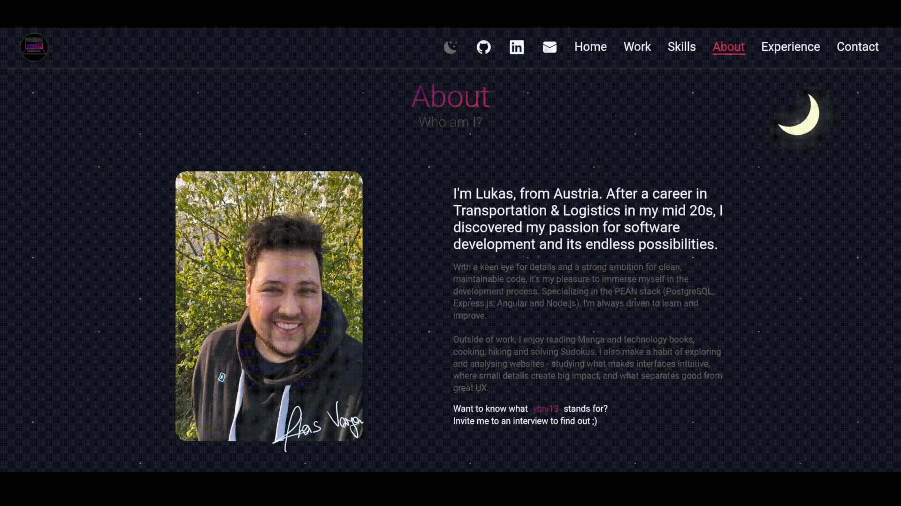

# yqni13 | $\texttt{\color{blueviolet}{PORTFOLIO}}$
### $\textsf{\color{brown}{v2.3.8}}$

<br>

### $\textsf{\color{teal}Hosting}$
My portfolio is live (see link) - hosted via <a href="https://app.netlify.com/">Netlify</a>.<br>
### visit my <a href="https://yqni13.com">Portfolio LIVE</a>

<br>

## 🪄 $\textsf{\color{salmon}Getting started}$

### $\textsf{\color{teal}Prerequisites}$

- node: v22+
- Angular v22

<br>

### $\textsf{\color{teal}Local setup}$


Download or clone project

```sh
git clone https://github.com/yqni13/portfolio
```

Create new environment file and fill in your credentials/other env data [(see docs)](./docs/CONFIGURATION.md).
<br>Navigate/cd into the root path /frontend and install dependencies via npm:
```sh
npm install
```
Start the application in local environment:
```sh
npm run start:dev
```
which will open automatically on `http://localhost:4200/`.

<br>

## 🧩 $\textsf{\color{salmon}Features}$

### $\textsf{\color{teal}Angular Signal-Form}$

With the update to Angular v22, Angular's new Signal Forms have been integrated into the custom form components: text-input, select-input, textarea and validation [(see form components)](./frontend/src/app/components/common/form).<br>The form on the 'contact' page allows visitors to write and send a text message [(see contact)](./frontend/src/app/components/pages/contact).

<br>

### $\textsf{\color{teal}Theme Switch Transition}$

Inspired by an Instagram post, I updated my light-mode colors and sought a more soothing and engaging transition for the theme switch. Using the View Transition API and some calculation logic (sponsored by AI), a snapshot creates the effect of the newly selected theme gliding over the old one [(see transition service)](./frontend/src/app/services/transition.service.ts).

<div align="center">
    
    Figure 1 - Theme switch transition, v2.3.8
</div>

<br>

### $\textsf{\color{teal}Angular ESLint}$

Using Angular ESLint to test for keeping rulesets and guidelines within the code for easier maintenance and first bug prevention.<br>
Install basic dependencies:
```sh
ng add @angular-eslint/schematics
```
Run command for linting the project:
```sh
ng lint
```

<br>

### $\textsf{\color{teal}Cross-browser testing}$

 |  |  |  | 
|:----:|:----:|:------:|:------:|:-------:|
|Brave | Edge | Opera  | Aloha  | Firefox |
|Yes   | Yes  | Yes    | Yes    | Yes*    |

<br>

*This browser has problems with some animations.

<br>

## 📈 $\textsf{\color{salmon}Updates}$
[see changelog for all updates](./docs/CHANGELOG.md)

$\textsf{[v2.3.5\ =>\ {\textbf{\color{brown}v2.3.8}]}}$ app
- $\textsf{\color{teal}Addition:}$ Added animation for theme switch transition.
- $\textsf{\color{orange}Patch:}$ Updated:
  + light mode colors from cold to warm tone
  + missing paddings/distance buffers
